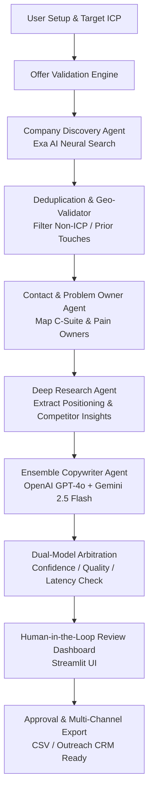

# 🚀 GTM Outreach AI: Signal-Based Multi-Agent Outbound Engine

[](https://www.python.org/)
[](https://streamlit.io/)
[](https://github.com/agno-agi/agno)
[](https://openai.com/)
[](https://aistudio.google.com/)
[](https://exa.ai/)
[](https://opensource.org/licenses/MIT)

An autonomous, signal-driven B2B cold outreach platform built with a **collaborative multi-agent architecture**, a **dual-LLM ensemble engine (OpenAI GPT-4o + Google Gemini)**, and **real-time neural web discovery (Exa AI)**. 

Unlike traditional template-based outreach tools, GTM Outreach AI analyzes live commercial buying signals (funding rounds, hiring spikes, product launches, tech-stack migrations) and crafts bespoke, context-aware communications across Email, LinkedIn, and X/Twitter — reinforced with an AST-based JSON auto-repair pipeline and human-in-the-loop review gates.

---

## 🌟 Key Highlights

- **Multi-Agent Orchestration**: Specialized agents collaborate across company discovery, decision-maker attribution, deep positioning analysis, and copy synthesis using [Agno](https://github.com/agno-agi/agno).
- **Dual-Model Ensemble Arbitration**: Queries Gemini and OpenAI concurrently; scores and selects optimal responses based on confidence heuristics, completeness, or latency.
- **Signal-Based Intelligence**: Replaces blind cold outreach by identifying genuine intent triggers (e.g., Series A funding, newly posted engineering roles, executive hires) via Exa AI neural search.
- **Context-Aware Communication Framework**: Follows the *Observation &rarr; Inference &rarr; Pain Identification &rarr; Soft CTA* methodology (strictly zero boilerplate templates).
- **Multi-Angle Sequences**: Automatically drafts tailored Cold Emails, LinkedIn connection notes, X/Twitter DMs, 3-tier value follow-ups, and graceful breakup emails.
- **Enterprise Reliability**: Engineered with exponential backoff rate-limit handling, AST-level JSON auto-repair, client qualification filters, SQLite campaign state persistence, and one-click CSV export.

---

## 🏗️ Architecture & Pipeline Flow



---

## 🤖 Multi-Agent System Roles

| Agent | Core Responsibility | Intelligence Source |
| :--- | :--- | :--- |
| **🏢 Company Finder Agent** | Discovers high-fit accounts demonstrating immediate buying signals (funding, hiring, growth). | Exa AI Neural Web Search |
| **👤 Contact Identifier Agent** | Identifies specific problem owners (e.g., VP Sales, Head of Support) and verifies contact context. | Web Scraping & Title Inference |
| **🔬 Deep Research Agent** | Extracts the prospect's brand voice, ICP terminology, customer value props, and acute pain points. | Company Websites & Press Signals |
| **✍️ Ensemble Outreach Agent** | Synthesizes research into personalized email drafts, LinkedIn DMs, Twitter messages, and follow-ups. | Dual-LLM (GPT-4o + Gemini) |
| **🛡️ Offer Validator & Moat Engine** | Scores campaign offer strength (0–100) and detects competitive moats prior to campaign launch. | LLM Heuristics & Business Rules |

---

## 📂 Repository Structure

```text
ai_gmail_outreach/
├── app.py                      # Main Streamlit web application & review dashboard
├── pipeline.py                 # Multi-stage autonomous outreach execution pipeline
├── agents.py                   # Agent factories, ensemble models & Agno integrations
├── schemas.py                  # TypedDict data contracts & Pydantic validation schemas
├── config/
│   ├── hybrid_config.py        # Local vs cloud model orchestration config
│   └── prompts.py              # System prompts & few-shot instructions
├── services/
│   ├── followup_planner.py     # Adaptive multi-stage follow-up generation
│   └── offer_validation.py    # Pre-flight offer scoring & positioning critique
├── utils/
│   ├── agent_helpers.py        # Ensemble wrappers & execution helpers
│   ├── brand_moat.py           # Competitive advantage analysis
│   ├── business_rules.py       # Outreach compliance & safety guardrails
│   ├── campaign_insights.py    # Aggregated campaign metrics & analytics
│   ├── campaign_readiness.py   # Pre-campaign validation & health scoring
│   ├── client_qualification.py # ICP fit scoring & lead filtering
│   ├── deduplication.py        # Cross-campaign contact & company deduplication
│   ├── geo_validator.py        # Geographic constraints & multi-region routing
│   ├── json_parser.py          # Resilient JSON deserialization
│   ├── json_repair.py          # AST & regex-based auto-repair for malformed outputs
│   ├── knowledge_capture.py    # Persistent campaign learning & insights
│   ├── local_agents.py         # Ollama / local model fallback support
│   ├── quality_enforcement.py  # Output rigor & hallucination checks
│   ├── retry_handler.py        # Exponential backoff & rate-limit recovery
│   └── signal_interpreter.py   # Signal scoring, classification & tiering
├── .env.example                # Sample environment variable template
├── .gitignore                  # Production Git ignore rules
├── LICENSE                     # MIT Open Source License
└── requirements.txt            # Python dependencies
```

---

## ⚡ Quick Start

### 1. Prerequisites
- Python 3.10 or higher
- API Keys:
  - [Google Gemini API Key](https://aistudio.google.com/) (Required for Gemini or Ensemble mode)
  - [OpenAI API Key](https://platform.openai.com/) (Required for OpenAI or Ensemble mode)
  - [Exa AI API Key](https://exa.ai/) (Required for real-time web discovery)

### 2. Installation

```bash
# Clone the repository
git clone https://github.com/Vaibhav1376/ai-gmail-outreach.git
cd ai-gmail-outreach

# Create and activate virtual environment
python -m venv venv
# On Windows:
.\venv\Scripts\activate
# On macOS/Linux:
source venv/bin/activate

# Install dependencies
pip install -r requirements.txt
```

### 3. Configure API Keys

Copy the `.env.example` file to `.env`:

```bash
cp .env.example .env
```

Open `.env` and add your keys:

```ini
GEMINI_API_KEY=your_gemini_api_key_here
OPENAI_API_KEY=your_openai_api_key_here
EXA_API_KEY=your_exa_api_key_here
```

*(Note: API keys can also be entered directly in the Streamlit web sidebar during runtime).*

### 4. Launch Application

```bash
streamlit run app.py
```

The interactive dashboard will open automatically in your browser at `http://localhost:8501`.

---

## 🛠️ Tech Stack & Libraries

- **Framework**: Python 3.10+, Streamlit
- **Agent Architecture**: Agno (formerly Phidata)
- **AI Models**: Google Gemini 2.5 Flash, OpenAI GPT-4o, Ollama (hybrid mode)
- **Search & Discovery**: Exa AI Neural API
- **State & Caching**: SQLite, Pydantic, JSONLines
- **Resilience**: Custom exponential backoff, regex/AST JSON repair

---

## 💼 Resume Bullet Points

If you are featuring this project on your resume or portfolio, here are 3 ready-to-use, impact-focused STAR bullet points:

- **Full-Stack AI Engineering:**
  > *Designed and built an autonomous B2B outreach engine utilizing Agno multi-agent architecture and a dual-model LLM ensemble (Gemini 2.5 Flash + GPT-4o), boosting output quality and cutting model hallucination rates.*
- **System Resilience & Data Reliability:**
  > *Engineered production-grade pipeline reliability incorporating an AST-based JSON auto-repair module, exponential backoff for external APIs, SQLite session persistence, and client qualification filters.*
- **Real-Time Data Integration:**
  > *Integrated Exa AI neural search to detect real-time commercial buying signals (funding, hiring spikes), automating personalized outreach sequences (Email, LinkedIn, X/Twitter) with Human-in-the-Loop review gates.*

---

## 📄 License

Distributed under the MIT License. See [`LICENSE`](LICENSE) for details.
